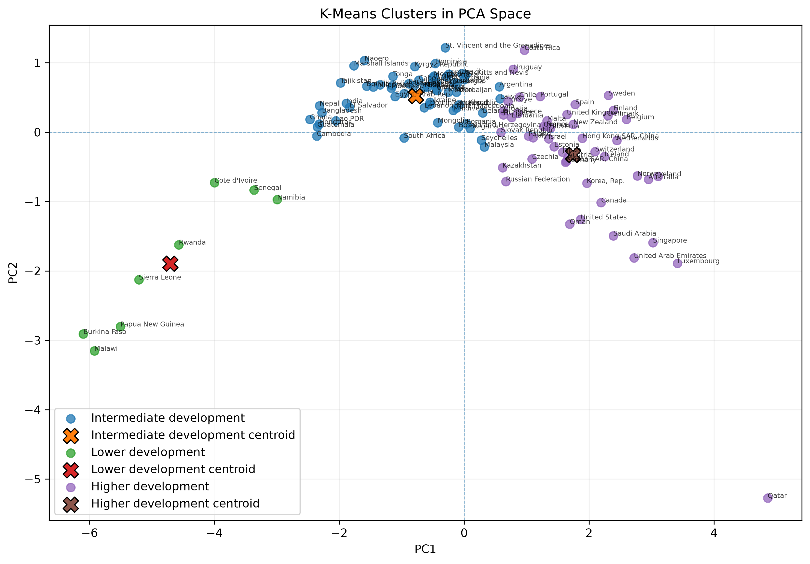

# Global Development PCA

A small Python data science project exploring socioeconomic indicators using Principal Component Analysis (PCA) and K-means clustering.

## About

I started this project to put my knowledge of Python, statistics, linear algebra, and data science into practice using real-world data.

The main goal was to understand how PCA works internally, which is why I implemented it from scratch using NumPy instead of relying entirely on Scikit-learn.

The project uses World Bank data to explore relationships between different socioeconomic indicators and identify groups of economies with similar characteristics.

## What I did

- Collected socioeconomic data using the World Bank API.
- Cleaned and prepared the dataset using Pandas.
- Performed exploratory data analysis and visualization.
- Implemented PCA from scratch using NumPy.
- Compared my implementation with Scikit-learn's PCA.
- Applied K-means clustering to group economies.
- Performed a small robustness analysis to compare PCA results across different datasets.

## Results

- Analyzed **115 economies** using six socioeconomic indicators.
- The first two principal components explained **80.78%** of the total variance.
- The first four components explained **94.96%**.
- Identified three groups of economies using K-means clustering.
- Successfully validated the custom PCA implementation against Scikit-learn.

## Technologies

Python · NumPy · Pandas · SciPy · Scikit-learn · Matplotlib · Seaborn · Pytest

## Visualization



## Running the project

```bash
git clone https://github.com/i-Moad/global-development-pca.git
cd global-development-pca

python -m venv .venv
.venv\Scripts\activate

pip install -r requirements.txt

$env:PYTHONPATH = "src"

python -m global_pca.data.pipeline
python -m pytest -v

python scripts/plot_clusters.py
```

## What I learned

This project helped me better understand the mathematics behind PCA, work with real-world datasets, and connect statistical concepts with practical Python implementations.


## Author

**AIT IDIR Moad**

Software Engineering Student

[GitHub](https://github.com/i-Moad) | [LinkedIn](https://www.linkedin.com/in/moad-ait)
